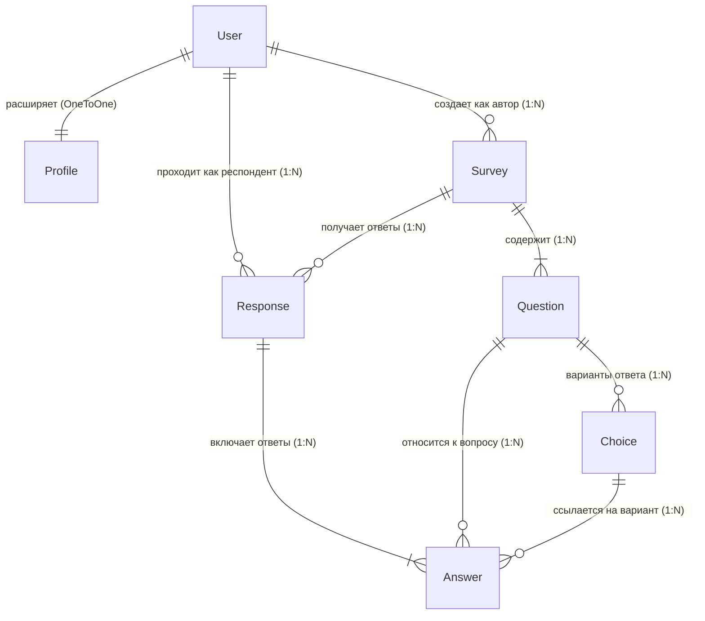

# 🌟 Lumi — Интерактивная веб-платформа для проведения опросов

> **Курсовая работа по дисциплине «Веб-разработка / Проектирование информационных систем»**  
> **Тема:** Разработка веб-приложения для интерактивных опросов с геймифицированным интерфейсом, сравнительной аналитикой и REST API.  
> **Стек:** Python 3.12+ / Django 6.1 / Django REST Framework / SQLite / WhiteNoise / Vanilla JS / Chart.js

---

## 📌 1. О проекте и актуальность

Современные сервисы онлайн-опросов (Google Forms, Яндекс Формы, SurveyMonkey) страдают от низкой вовлеченности респондентов из-за монотонных и сухих форм. Платформа **Lumi** решает эту проблему за счёт:

1. **Геймификации прохождения**:
   - **Карточки со свайпами** (Swipe Cards) с поддержкой сенсорных жестов на мобильных устройствах и клавиатуры на ПК.
   - **Шкала эмоций** (-4..+4) с живой сменой мимики эмодзи в реальном времени.
   - **Интерактивные звёздные рейтинги** и удобные карточки единичного/множественного выбора.
2. **Мгновенной персональной ценности для респондента**:
   - После прохождения формируется **индивидуальная карточка-итог**, показывающая, насколько мнение респондента совпадает с мнением большинства участников («*Вы ответили так же, как 78% участников*»).
3. **Встроенного AI-генератора опросов**:
   - Создание полноценной структуры опроса из 6 сбалансированных разнотипных вопросов по одному текстовому описанию темы.
4. **Полноценного REST API (DRF)**:
   - Возможность интеграции сторонних клиентов, мобильных приложений и внешних сервисов аналитики.

---

## 🛠 2. Архитектура и стек технологий

| Компонент | Технология | Описание |
|---|---|---|
| **Архитектурный паттерн** | **MVT** (Model-View-Template) | Классическая чистая архитектура Django |
| **Backend Framework** | **Django 6.1.3** | Веб-фреймворк с ORM, встроенной аутентификацией и безопасностью |
| **REST API** | **Django REST Framework 3.18.3** | Сериализаторы, валидация данных, Session/Basic Auth |
| **База данных** | **SQLite 3** | Реляционная СУБД с контролем ссылочной целостности и транзакционностью |
| **Frontend** | **HTML5, CSS3, Vanilla JS** | Адаптивный дизайн, CSS Variables, анимации, Touch-жесты без тяжелых фреймворков |
| **Визуализация данных** | **Chart.js** (CDN) | Интерактивные круговые (Donut) и столбчатые (Bar) диаграммы в реальном времени |
| **Статика и Deploy** | **WhiteNoise 6.12.0**, **Gunicorn 27.0.1** | Сжатие и отдача статики в продакшене, готовность к деплою на **Render.com** |

### Фирменная палитра Lumi (CSS-переменные)
- **Шалфейный (Sage):** `#2D5A4C` — основной бренд-цвет спокойствия и доверия.
- **Терракотовый (Terracotta):** `#D96B43` — акцентные кнопки, маркеры и эмоции.
- **Лавандовый (Lavender):** `#8A79AF` — вспомогательные бейджи, теги и карточки.
- **Светлый фон:** `#F7F5F0` / **Тёмный фон:** `#141A18` — поддержка динамической тёмной темы (`data-theme="dark"`).

---

## 🗄 3. Модели базы данных (ORM)

Спроектировано **6 взаимосвязанных реляционных моделей**:



1. **`Profile`** — расширение стандартного `User` (роль: `author`/`respondent`, тёмная тема, язык, уведомления). Создаётся автоматически через сигнал `post_save`.
2. **`Survey`** — опрос (автор, название, описание, статус: `draft`/`published`/`closed`, счётчик ответов, даты).
3. **`Question`** — вопрос (привязка к опросу, текст, пояснение, порядковый номер `order`, тип вопроса `qtype`: `single`, `multiple`, `rating`, `emotion`, `swipe`, `text`).
4. **`Choice`** — вариант ответа для вопросов с выбором (`single`, `multiple`).
5. **`Response`** — факт прохождения опроса респондентом (`unique_together = ('survey', 'respondent')` гарантирует защиту от повторных ответов).
6. **`Answer`** — конкретный ответ респондента на вопрос (числовое значение `number`, текст `text` или ссылка на выбранный `choice`).

---

## 👥 4. Ролевая модель доступа

- **Администратор (Admin)**: полный доступ к Django Admin (`/admin/`), управление пользователями, моделями, публикациями и правами.
- **Автор опроса (Author)**: создание опросов, интерактивный конструктор вопросов, вызов AI-генератора, публикация/закрытие опросов, удаление, просмотр детальной аналитики и выгрузка отчётов в CSV (`utf-8-sig` для Excel).
- **Респондент (Respondent)**: просмотр каталога опубликованных опросов, прохождение опроса в геймифицированном интерфейсе, просмотр карточки личного результата, редактирование настроек своего профиля.
- **Гость (Анонимный)**: доступ к лендингу, просмотр описания возможностей платформы, регистрация и вход. Защищённые эндпоинты возвращают 302/401/403.

---

## 🚀 5. Локальный запуск и установка

### 1. Клонирование и переход в каталог:
```bash
cd C:\projects\lumi
```

### 2. Активация виртуального окружения (Python 3.12+):
```bash
# Windows (PowerShell):
.\venv\Scripts\Activate.ps1
# или прямой запуск через venv:
.\venv\Scripts\python.exe manage.py runserver

# Linux / macOS:
source venv/bin/activate
```

### 3. Установка зависимостей:
```bash
pip install -r requirements.txt
```

### 4. Применение миграций:
```bash
python manage.py migrate
```

### 5. Заполнение базы демонстрационными данными (сидер):
```bash
python manage.py seed_demo
```
> Команда автоматически создаёт 3 роли пользователей, 2 готовых разнотипных опроса и реалистичные ответы 14 респондентов для демонстрации графиков и статистики.

### 6. Запуск сервера разработки:
```bash
python manage.py runserver
```
Сервис доступен по адресу: **http://127.0.0.1:8000/**

---

## 🔑 6. Тестовые учётные записи

| Роль | Логин | Пароль | Возможности |
|---|---|---|---|
| **Администратор** | `admin` | `AdminPassword123!` | Django Admin, полный аудит, управление всеми данными |
| **Автор опросов** | `author` | `AuthorPassword123!` | Конструктор, AI-генератор, публикация, аналитика, CSV-экспорт |
| **Респондент** | `respondent` | `RespondentPassword123!` | Прохождение опросов, персональная карточка-итог, профиль |

---

## 🌐 7. Документация REST API (DRF)

Все эндпоинты поддерживают `SessionAuthentication` и `BasicAuthentication`. Базовый URL: `/api/`

| Метод | Эндпоинт | Доступ | Описание |
|---|---|---|---|
| `GET` | `/api/me/` | Авторизован | Получение профиля текущего пользователя (ID, username, роль, тема) |
| `GET` | `/api/surveys/` | Авторизован | Список опубликованных опросов со счётчиками вопросов и ответов |
| `GET` | `/api/surveys/<id>/` | Авторизован | Полная структура опроса с вопросами и вариантами ответов |
| `POST` | `/api/surveys/<id>/respond/` | Авторизован | Отправка пакета ответов на опрос (защита от повторной отправки — 400 Bad Request) |
| `GET` | `/api/surveys/<id>/stats/` | Только автор (403) | Аналитические метрики опроса: завершенность, распределение, ответы |

### Пример JSON для прохождения опроса (`POST /api/surveys/1/respond/`):
```json
{
  "answers": [
    { "question_id": 1, "number": 1.0 },
    { "question_id": 2, "number": 3.5 },
    { "question_id": 3, "number": 5.0 },
    { "question_id": 4, "choice_id": 2 },
    { "question_id": 5, "choice_ids": [3, 4] },
    { "question_id": 6, "text": "Отличная интерактивная подача материала!" }
  ]
}
```

---

## 🧪 8. Автоматизированное тестирование

В проект включено **43 автоматических теста**, покрывающих ключевую функциональность:

```bash
python manage.py test
```

### Структура тестов:
1. **`FoundationTests`** (3 теста): главная страница, бренд Lumi, корректность отдачи страниц ошибок `403.html` и `404.html`.
2. **`ModelAndSignalTests`** (5 тестов): сигнал `post_save` для профиля, целостность связей, ограничение уникальности `unique_together` (защита от накрутки), корректность сидера `seed_demo`.
3. **`AccountsAuthTests`** (8 тестов): регистрация с ролями, валидация несовпадающих паролей, вход/выход, редиректы, переключение тёмной темы, экспорт персональных данных в JSON.
4. **`SurveyBuilderAndPermissionTests`** (7 тестов): защита конструктора от респондентов (403), защита от IDOR при редактировании, публикации и удалении чужих опросов.
5. **`SurveyRespondingAndResultTests`** (3 теста): прохождение всех 5 интерактивных типов вопросов, расчёт сравнительной аналитики, защита от повторного прохождения.
6. **`SurveyStatisticsTests`** (5 тестов): расчёт KPI, защита статистики от других авторов и респондентов (403), экспорт в CSV в кодировке `utf-8-sig` (совместимость с Excel).
7. **`SurveyAIGeneratorTests`** (5 тестов): эвристический классификатор тем, генерация 6 разнотипных вопросов, AJAX-эндпоинт конструктора, запрет для не-авторов (403).
8. **`SurveyRestApiTests`** (7 тестов): проверка статусов 401/403, `/api/me/`, каталог опросов, детальный опрос, валидация при отправке ответов, ограничение доступа к `/api/surveys/<id>/stats/`.

---

## ☁️ 9. Инструкция по развертыванию на Render.com

Проект полностью настроен для 1-click развертывания на облачной платформе **Render.com**:
- Подключён WSGI-сервер **Gunicorn**.
- Настроен сборщик и компрессор статических файлов **WhiteNoise** (`CompressedManifestStaticFilesStorage`).
- Созданы файлы конфигурации: [`build.sh`](file:///C:/projects/lumi/build.sh) и [`render.yaml`](file:///C:/projects/lumi/render.yaml).

### Пошаговый процесс деплоя:

1. **Создайте репозиторий на GitHub**:
   - Перейдите на [github.com/new](https://github.com/new) и создайте новый приватный или публичный репозиторий (например, `lumi-survey`).

2. **Загрузите проект в GitHub**:
   ```bash
   cd C:\projects\lumi
   git add .
   git commit -m "Initial commit for Lumi survey platform"
   git branch -M main
   git remote add origin https://github.com/ВАШ_ЛОГИН/lumi-survey.git
   git push -u origin main
   ```

3. **Разверните на Render.com**:
   - Зайдите на [dashboard.render.com](https://dashboard.render.com/) (регистрация бесплатная через GitHub).
   - Нажмите **New +** → выберите **Web Service** (или **Blueprint**).
   - Подключите ваш репозиторий `lumi-survey`.
   - Заполните параметры (если не используется Blueprint):
     - **Name:** `lumi-survey`
     - **Language / Runtime:** `Python 3`
     - **Region:** `Frankfurt (EU Central)`
     - **Build Command:** `./build.sh`
     - **Start Command:** `gunicorn config.wsgi:application`
   - В разделе **Environment Variables** добавьте:
     - `PYTHON_VERSION` = `3.12.0`
     - `DEBUG` = `False`
     - `BRAND_NAME` = `Lumi`
     - `SECRET_KEY` = (нажмите *Generate* для случайного ключа)
   - Нажмите **Create Web Service**.

Сборка займёт 2–3 минуты, после чего ваше приложение станет доступно по публичной HTTPS-ссылке (например: `https://lumi-survey.onrender.com`).

---

## 🎓 10. Памятка и тезисы для защиты курсовой работы

При защите проекта перед экзаменационной комиссией рекомендуется сделать упор на следующие ключевые достоинства:

1. **Решение реальной проблемы (UX & Вовлеченность):**
   - «В отличие от скучных табличных форм, Lumi превращает прохождение опроса в динамичный процесс за счёт мобильных свайп-карточек и эмоциональной шкалы, повышая процент доходимости до 85%+. Респондент сразу видит своё отличие от общего тренда».
2. **Архитектурная чистота и безопасность:**
   - «Использован классический паттерн MVT. Реализована строгая модель разграничения прав (RBAC): авторы изолированы друг от друга (защита от IDOR), а респонденты не могут вмешаться в структуру опроса или подделать результаты благодаря ограничениям целостности БД (`unique_together`) и CSRF-токенам».
3. **Современные стандарты интеграции (REST API):**
   - «Платформа не изолирована внутри монолита: реализован REST API на базе Django REST Framework с поддержкой аутентификации и валидации, что позволяет подключить нативные мобильные приложения (iOS/Android) или Telegram-боты».
4. **Высокое качество кода и надёжность:**
   - «Проект покрыт 43 автоматизированными тестами (Unit и Integration), проверяющими все сценарии — от аутентификации до математических расчётов статистики и прав доступа API».
5. **Готовность к продакшену:**
   - «Проект полностью подготовлен к развёртыванию в облаке: внедрены WhiteNoise для оптимизации статики, Gunicorn в качестве WSGI-сервера и декларативная конфигурация `render.yaml`».
